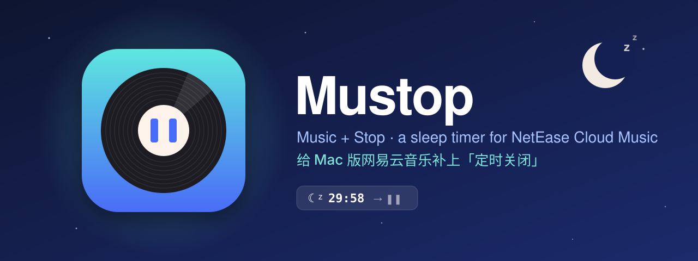
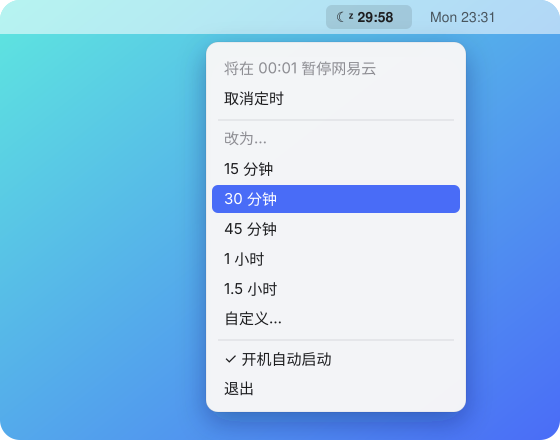
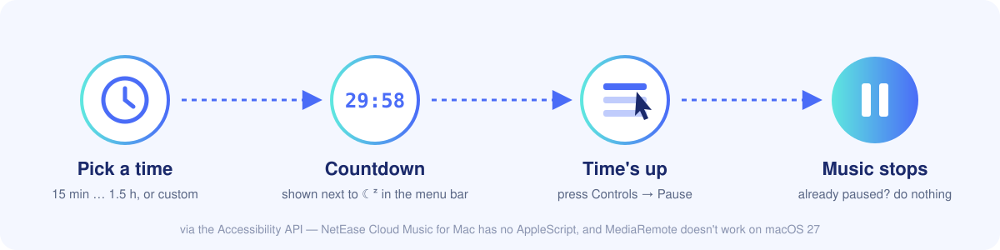

<p align="center">
  
</p>

<p align="center">
  <a href="README.md">简体中文</a> · <b>English</b>
</p>

<p align="center">
  <a href="https://github.com/51younglowkey/Mustop/releases/latest"></a>
  
  
  <a href="LICENSE"></a>
</p>

# Mustop

**Mu**sic + **Stop**. A tiny menu bar app: set a timer, and when it runs out, NetEase Cloud Music (网易云音乐) pauses.

The NetEase Cloud Music phone app has a sleep timer. The Mac app doesn't. Fall asleep with music on and it keeps playing until morning. Mustop fills that gap.

<p align="center">
  
</p>

## Features

- **Lives in the menu bar.** Click the 🌙 icon and pick 15 / 30 / 45 minutes, 1 hour, 1.5 hours, or "自定义…" (custom) to type any number of minutes.
- **Visible countdown.** The remaining time sits next to the icon. Cancel or change it at any time.
- **Pauses, never plays.** Mustop only presses Pause while music is actually playing. If it's already stopped, Mustop does nothing — it will never turn your music back on.
- **Works even when the icon is hidden.** Open Mustop directly (double-click or Spotlight) and the menu pops up at your mouse pointer. Handy if you use a menu bar manager like Bartender or Ice.
- **Launch at login.** One checkbox in the menu. It stays quiet when launched at login.
- **Tiny.** About 200 lines of Swift in one file. No third-party dependencies, no network access, no data collection.

> The menu is in Chinese for now, since NetEase Cloud Music users are mostly Chinese speakers. An English UI would be a welcome PR.

## Install

1. Download `Mustop-x.y.zip` from [Releases](https://github.com/51younglowkey/Mustop/releases/latest), unzip it, and move `Mustop.app` into `/Applications` or `~/Applications`.
2. The first time you open it, macOS will say the developer can't be verified (Mustop is not notarized by Apple). Either:
   - **Right-click → Open** in Finder, then click "Open"; or
   - run this in Terminal:

     ```sh
     xattr -dr com.apple.quarantine /Applications/Mustop.app
     ```

3. Grant Accessibility permission (next section).

## Permissions

Mustop needs **System Settings → Privacy & Security → Accessibility** (called "Device Control & Data Access" on macOS 27) so it can press Pause in NetEase Cloud Music's menu bar.

- macOS shows a prompt the first time Mustop runs.
- If Mustop isn't in the list, click **+** at the bottom left, add `Mustop.app`, and turn it on.
- Until permission is granted, Mustop's menu shows "⚠️ 未授权辅助功能，点此去设置" (Accessibility not granted, click to open settings).

## How it works

<p align="center">
  
</p>

NetEase Cloud Music for Mac (3.1.12) has no AppleScript dictionary. The system MediaRemote pause command reports success on macOS 27 but does nothing.

So Mustop takes the boring but reliable route: through the Accessibility API it reads the app's `Controls → Pause` menu item (`控制 → 暂停` in the Chinese UI), and **presses it only when it says "Pause"**, which means music is playing.

If a future NetEase update renames those menu items, edit `controlsTitles` / `pauseTitles` in [`Sources/main.swift`](Sources/main.swift).

## Build from source

You only need the Xcode Command Line Tools (`swiftc`), not Xcode itself.

```sh
git clone https://github.com/51younglowkey/Mustop.git
cd Mustop
make build      # compile, sign, and install to ~/Applications/Mustop.app
make release    # build a universal (arm64 + x86_64) zip into dist/Mustop-x.y.zip
make icon       # regenerate Resources/AppIcon.icns from Scripts/make-icon.swift
```

About signing:

- The build script signs with a local certificate named `YoungBar Local Signing` by default. Use your own with `MUSTOP_SIGN_IDENTITY="Your Cert Name" make build`.
- If the certificate isn't found, it falls back to ad-hoc signing. That works, but an ad-hoc identity changes on every rebuild, so **the Accessibility grant stops working** and you have to remove and re-add Mustop in System Settings.
- To avoid that, create a self-signed "Code Signing" certificate in Keychain Access → Certificate Assistant → Create a Certificate, and always sign with it.

## Self-test

```sh
~/Applications/Mustop.app/Contents/MacOS/Mustop --pause-now
```

Tries to pause once, right now, and prints the result:

| Output | Meaning |
| --- | --- |
| `paused` | Paused successfully |
| `alreadyStopped` | Already stopped, nothing done |
| `notRunning` | NetEase Cloud Music isn't running |
| `noPermission` | No Accessibility permission |
| `menuNotFound` | Couldn't find the Pause menu item (maybe the app changed) |

> [!WARNING]
> If music is playing, this command really pauses it.

When run from Terminal, it uses Terminal's own Accessibility permission. To test Mustop's own grant, use:

```sh
open -n ~/Applications/Mustop.app --args --pause-now
```

## FAQ

**The timer ran out but nothing paused?**
Run the self-test above. Usually Accessibility isn't granted, or the grant broke after a rebuild (see "About signing").

**Does it support QQ Music / Spotify / Apple Music?**
Only NetEase Cloud Music for now. The approach is generic — swap in another app's bundle ID and menu titles. PRs welcome.

## License

[MIT](LICENSE)
