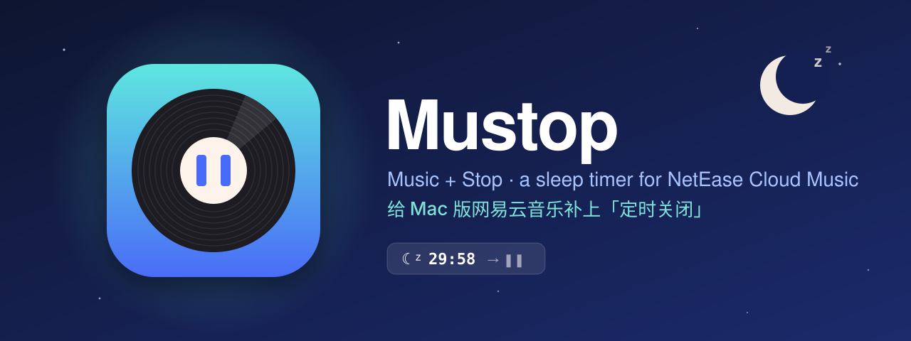
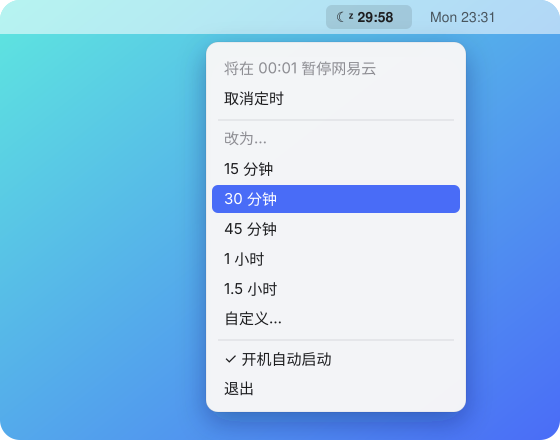

<p align="center">
  
</p>

<p align="center">
  <b>简体中文</b> · <a href="README.en.md">English</a>
</p>

<p align="center">
  <a href="https://github.com/51younglowkey/Mustop/releases/latest"></a>
  
  
  <a href="LICENSE"></a>
</p>

# Mustop

**Mu**sic + **Stop**。一个菜单栏小工具：设一个时间，到点让网易云音乐暂停。

手机上的网易云有「定时关闭」，Mac 版没有。睡前躺着听歌、听着听着睡着了，音乐会一直放到天亮。Mustop 补上这个缺口。

<p align="center">
  
</p>

## 特点

- **菜单栏常驻**：点 🌙 图标，选 15 / 30 / 45 分钟、1 小时、1.5 小时，或者「自定义…」输入分钟数。
- **倒计时一目了然**：计时中图标旁显示剩余时间，随时可以「取消定时」或改成别的时长。
- **只暂停，不误开**：只有网易云正在播放时才按暂停；本来就停着，Mustop 什么都不做，不会反过来把音乐打开。
- **图标被藏起来也能用**：直接双击 / Spotlight 打开 Mustop，菜单会在鼠标处弹出。适合用 Bartender、Ice 之类菜单栏管理工具的人。
- **开机自动启动**：菜单里勾一下即可，开机启动时不会弹菜单打扰你。
- **轻**：一个 200 行左右的 Swift 文件，没有任何第三方依赖，不联网，不收集数据。

## 安装

1. 到 [Releases](https://github.com/51younglowkey/Mustop/releases/latest) 下载 `Mustop-x.y.zip`，解压后把 `Mustop.app` 拖进「应用程序」或 `~/Applications`。
2. 第一次打开时，macOS 会提示「无法验证开发者」（Mustop 没有经过 Apple 公证）。两种办法任选：
   - 在 Finder 里**右键 → 打开**，再点「打开」；
   - 或者在终端执行：

     ```sh
     xattr -dr com.apple.quarantine /Applications/Mustop.app
     ```

3. 授予辅助功能权限（见下一节）。

## 权限

Mustop 需要「系统设置 → 隐私与安全性 → **辅助功能**」权限（macOS 27 上叫「设备控制与数据访问」），用来按下网易云菜单栏里的「暂停」。

- 首次运行时系统会弹出授权提示。
- 如果列表里没有 Mustop，点左下角「**+**」手动添加 `Mustop.app`，再打开开关。
- 没授权时，Mustop 的菜单里会出现「⚠️ 未授权辅助功能，点此去设置」。

## 原理

<p align="center">
  
</p>

网易云音乐 Mac 版（3.1.12）没有 AppleScript 字典；系统 MediaRemote 发出的暂停命令在 macOS 27 上返回成功，但实际不生效。

所以 Mustop 走最笨也最可靠的路：通过辅助功能 API 读网易云菜单栏里的 `Controls → Pause`（中文界面是「控制 → 暂停」），并且**只在菜单项显示「暂停」（也就是正在播放）时才按下去**。

如果哪天网易云改版改了菜单文案，改 [`Sources/main.swift`](Sources/main.swift) 里的 `controlsTitles` / `pauseTitles` 即可。

## 从源码构建

只需要 Xcode 命令行工具（`swiftc`），不需要 Xcode。

```sh
git clone https://github.com/51younglowkey/Mustop.git
cd Mustop
make build      # 编译、签名，并安装到 ~/Applications/Mustop.app
make release    # 打包通用二进制（arm64 + x86_64）到 dist/Mustop-x.y.zip
make icon       # 从 Scripts/make-icon.swift 重新生成 Resources/AppIcon.icns
```

关于签名：

- 构建脚本默认用名为 `YoungBar Local Signing` 的本机证书签名，可以用环境变量换成你自己的：`MUSTOP_SIGN_IDENTITY="你的证书名" make build`。
- 找不到证书时会退回 ad-hoc 签名。能用，但 ad-hoc 签名每次重编译后身份都会变，**辅助功能授权会失效**，需要在系统设置里删掉旧条目再重新添加。
- 想一劳永逸，可以在「钥匙串访问 → 证书助理 → 创建证书」里建一个自签名的「代码签名」证书，以后都用它签。

## 自检

```sh
~/Applications/Mustop.app/Contents/MacOS/Mustop --pause-now
```

立即尝试暂停一次，并打印结果：

| 输出 | 含义 |
| --- | --- |
| `paused` | 暂停成功 |
| `alreadyStopped` | 本来就停着，什么都没做 |
| `notRunning` | 网易云没开 |
| `noPermission` | 没有辅助功能权限 |
| `menuNotFound` | 找不到暂停菜单项（可能网易云改版了） |

> [!WARNING]
> 网易云正在播放时，这条命令会真的把它暂停。

从终端运行时用的是终端自己的辅助功能权限。要验证 Mustop 本身的授权，用：

```sh
open -n ~/Applications/Mustop.app --args --pause-now
```

## 常见问题

**到点了没暂停？**
先跑一下上面的自检。最常见的是辅助功能没授权，或者重新编译后授权失效了（见「从源码构建 → 关于签名」）。

**支持 QQ 音乐 / Spotify / Apple Music 吗？**
目前只做网易云。原理是通用的——换成别的 App 的 bundle ID 和菜单文案就行，欢迎 PR。

**界面是中文的？**
是的，菜单目前只有中文。英文界面欢迎 PR。

## 许可

[MIT](LICENSE)
